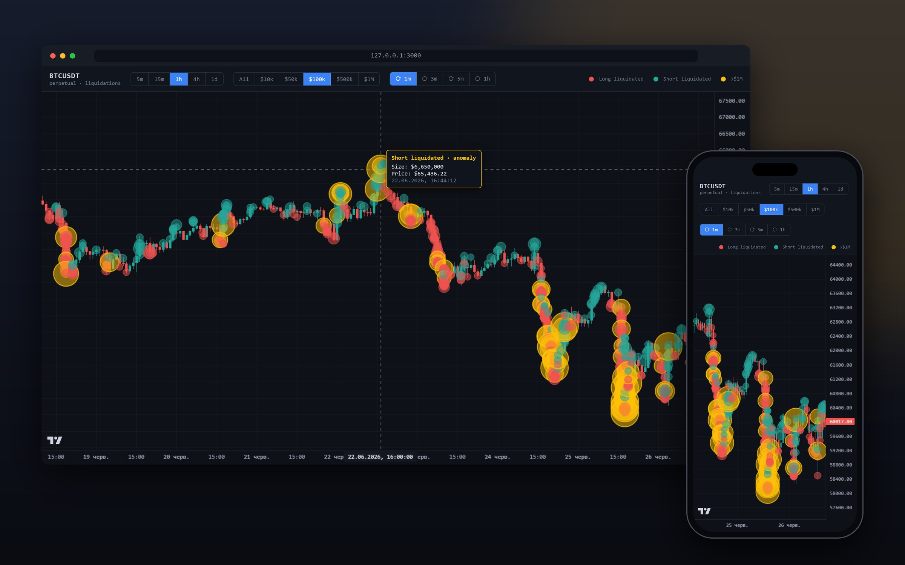

<div align="center">

# 🫧 BTC Liquidation Map — Binance Futures

**See where the market forced traders out.**
A real-time BTCUSDT perpetual chart with every liquidation drawn as a bubble at its exact price
and time, sized by its value in USDT.

[](https://nodejs.org/)
[](https://www.typescriptlang.org/)
[](https://react.dev/)
[](https://vite.dev/)
[](https://tradingview.github.io/lightweight-charts/)
[](https://github.com/WiseLibs/better-sqlite3)
[](https://developers.binance.com/docs/derivatives/usds-margined-futures/general-info)
[](LICENSE)



</div>

---

## 📋 Table of Contents

- [✨ Features](#-features)
- [⚙️ How It Works](#️-how-it-works)
- [🧰 Tech Stack](#-tech-stack)
- [🚀 Quick Start](#-quick-start)
- [🎛️ Using the Chart](#️-using-the-chart)
- [🔌 API](#-api)
- [🗄️ Database](#️-database)
- [📥 Importing History from Telegram](#-importing-history-from-telegram)
- [📜 Scripts](#-scripts)
- [🗂️ Project Structure](#️-project-structure)
- [🔧 Configuration](#-configuration)
- [☁️ Deployment](#️-deployment)
- [🚧 Known Limitations](#-known-limitations)
- [📄 License](#-license)

---

## ✨ Features

### 📈 Chart

|                             |                                                                                          |
| --------------------------- | ---------------------------------------------------------------------------------------- |
| 🕯️ **Candles**              | BTCUSDT perpetual, five timeframes: 5m · 15m · 1h · 4h · 1d                              |
| 🫧 **Liquidation bubbles**  | Every liquidation at its exact price and time; bubble **area ∝ USD value**               |
| 🎨 **Side by colour**       | 🔴 long liquidated (forced sell) · 🟢 short liquidated (forced buy) · 🟡 anomaly ≥ $1M    |
| 🔎 **Size filter**          | All · $10k · $50k · $100k · $500k · $1M — applied instantly, no refetch                  |
| 💬 **Tooltips**             | Hover a bubble: side, size in USD, price, date and time                                  |
| ⚡ **Real time**            | New liquidations are pushed over a WebSocket and appear the moment they happen           |
| 🔄 **Live candles**         | The forming bar grows; refresh interval 1m · 3m · 5m · 1h                                |
| 🧭 **Navigation**           | Zoom in / out and "jump to latest" buttons appear when you touch the chart               |
| 💾 **Remembers you**        | Timeframe, filter, refresh interval and the zoom of **each** timeframe survive a reload  |
| 🕐 **Kyiv time**            | Axis, crosshair and tooltips in Europe/Kyiv, daylight saving handled by `Intl`           |
| 📱 **Responsive**           | The toolbar wraps on narrow screens; works on phones                                     |

### 🛠️ Backend

- 📡 **Collector** — a persistent connection to the Binance liquidation stream with exponential
  back-off reconnect (1 s → 30 s); malformed frames are dropped, never crash the process.
- 🕯️ **Candle cache** — first run backfills **60 days** of 5m/15m and **365 days** of 1h/4h/1d;
  every later start fetches only the missing bars; a 60-second loop keeps the current bar fresh.
- 🗄️ **SQLite store** — WAL mode, prepared statements, idempotent inserts: re-runs and overlapping
  imports never create duplicates.
- 📥 **History import** — years of past BTC liquidations from a Telegram channel export.
- 🧩 **One port** — REST API, WebSocket and the built frontend are served by one Node process.

---

## ⚙️ How It Works

```text
                     Binance USDⓈ-M Futures
       ┌──────────────────────────┬─────────────────────────────┐
       │ wss://fstream.binance.com│ https://fapi.binance.com    │
       │ /market/ws/btcusdt@      │ /fapi/v1/klines             │
       │ forceOrder               │ (1500 bars per page)        │
       └────────────┬─────────────┴──────────────┬──────────────┘
                    │ liquidation events          │ OHLCV bars
                    ▼                             ▼
          ┌──────────────────┐          ┌──────────────────┐
          │ collector.ts     │          │ candles.ts       │
          │ normalize, store │          │ backfill + 60 s  │
          └───┬──────────┬───┘          │ refresh          │
              │          │              └────────┬─────────┘
              │          ▼                       ▼
              │   ┌──────────────────────────────────────┐      result.json
              │   │ SQLite  server/btc-liq.db            │◄──── (Telegram export)
              │   │ liquidations · candles               │      import-telegram.ts
              │   └──────────────────┬───────────────────┘
              ▼                      ▼
      ┌──────────────┐      ┌──────────────────┐
      │ hub.ts  /ws  │      │ api.ts  /api/*   │      express.static(server/public)
      └──────┬───────┘      └────────┬─────────┘
             │ push                  │ REST
             ▼                       ▼
   ┌────────────────────────────────────────────────────────┐
   │ Browser — React + Lightweight Charts                    │
   │ Chart.tsx (candles, polling) · LiquidationPrimitive.ts  │
   │ (canvas bubbles, hit-testing, tooltip)                  │
   └────────────────────────────────────────────────────────┘
```

**Startup sequence** (`server/src/index.ts`):

1. Open `server/btc-liq.db` (created with its schema if missing).
2. Bring the candle cache up to date — if Binance is unreachable, the server still starts with the
   cached data.
3. Start the liquidation collector; each event goes to the database **and** to every open browser.
4. Serve the API, the `/ws` socket and the frontend on `http://127.0.0.1:3000`.
5. `SIGINT` / `SIGTERM` stop the collector and the refresh loop and close the database cleanly.

**How a liquidation becomes a bubble:**

| Step | What happens                                                                                     |
| :--: | ------------------------------------------------------------------------------------------------ |
|  1   | Binance sends a `forceOrder` event: order side `S`, average price `ap`, filled quantity `z`      |
|  2   | Side is translated to the **position** that was closed: `SELL` → `LONG`, `BUY` → `SHORT`         |
|  3   | Notional `usd = ap × z` is stored with the event so filtering never recomputes it                |
|  4   | In the browser the time is snapped to the start of its candle for the active timeframe           |
|  5   | Radius = `3 px + √(usd / $5M) × 25 px` (capped at 28 px) — area grows linearly with value        |
|  6   | Drawn on the chart canvas above the candles at 50 % opacity, so price action stays visible       |

---

## 🧰 Tech Stack

| Layer     | Technology                                                                               |
| --------- | ---------------------------------------------------------------------------------------- |
| Runtime   | **Node.js 18+** (tested on 22 and 24), ES modules                                         |
| Language  | **TypeScript 5** — `strict` on both sides                                                 |
| Server    | **Express 4** (REST + static files), **ws 8** (Binance stream client and browser hub)     |
| Database  | **SQLite** via **better-sqlite3 11** — WAL journal, prepared statements                   |
| Frontend  | **React 18**, **Vite 6**, hand-written CSS (dark trading-terminal theme)                  |
| Charting  | **TradingView Lightweight Charts 5** + a custom `ISeriesPrimitive` for the bubbles        |
| Data      | Binance USDⓈ-M Futures public market data — **no API key needed**                         |

> Three runtime dependencies on the server (`express`, `ws`, `better-sqlite3`) and three in the
> browser (`react`, `react-dom`, `lightweight-charts`).

---

## 🚀 Quick Start

**Requirements:** Node.js **18+** and outbound access to `fapi.binance.com` and
`fstream.binance.com`.

```bash
# 1. Clone
git clone https://github.com/lpcms/btc-liquidation.git
cd btc-liquidation

# 2. Install dependencies of server/ and web/ (once)
npm run install:all

# 3. Build the frontend and the backend, then start the server
npm start
```

Open **http://127.0.0.1:3000**

The first start backfills about 35 000 candles from Binance — usually under a minute. Candles
appear immediately; liquidation bubbles accumulate as live events arrive and are kept in the
database between runs. To see years of history at once, [import it from Telegram](#-importing-history-from-telegram).

**Every next run**, if the code has not changed:

```bash
npm run serve        # start without rebuilding
```

### 🔥 Development (hot reload, two terminals)

```bash
cd server && npm run build && npm start   # backend on :3000
cd web && npm run dev                     # Vite on :5173, proxies /api and /ws to :3000
```

Open the URL Vite prints (usually http://localhost:5173). For the backend, `npm run dev` in
`server/` runs `tsc --watch`; restart `npm start` after a change.

---

## 🎛️ Using the Chart

| Control              | Options                                         | Default |
| -------------------- | ----------------------------------------------- | :-----: |
| Timeframe            | `5m` `15m` `1h` `4h` `1d`                       |  `1h`   |
| Minimum bubble size  | `All` `$10k` `$50k` `$100k` `$500k` `$1M`        |  `All`  |
| Refresh interval     | `⟳ 1m` `⟳ 3m` `⟳ 5m` `⟳ 1h`                     | `⟳ 1m`  |

| Bubble     | Meaning                                                              |
| ---------- | -------------------------------------------------------------------- |
| 🔴 Red     | **Long liquidated** — a long position was force-closed with a sell   |
| 🟢 Green   | **Short liquidated** — a short position was force-closed with a buy  |
| 🟡 Amber   | **Anomaly** — any liquidation of **$1M or more**, whatever the side  |

- **Mouse wheel / pinch** zooms, **drag** pans. The `+` `−` `»` buttons fade in at the bottom right
  while you interact with the chart; `»` jumps back to the latest bar.
- **Hover a bubble** for its details; where bubbles overlap, the largest one wins.
- Settings are saved in `localStorage` (`btcliq.settings`), and the visible range is saved per
  timeframe (`btcliq.range.<tf>`), so every timeframe reopens where you left it.

> 💡 The live WebSocket adds new bubbles immediately; the refresh interval controls how often the
> candles (and the full liquidation list) are re-read from the server.

---

## 🔌 API

All endpoints are read-only `GET` requests. Invalid input returns `400` with a short message.

| Endpoint                                     | Returns                                                                     |
| -------------------------------------------- | --------------------------------------------------------------------------- |
| `/api/timeframes`                            | `[{ interval, barSeconds }]` for the five timeframes                        |
| `/api/candles?tf=1h&from=&to=`               | OHLCV bars; `tf` required, `from` / `to` in **seconds** (optional)          |
| `/api/liquidations?from=&to=&minUsd=`        | Liquidations, oldest first; `from` / `to` in **milliseconds**, `minUsd` ≥ 0 |

```jsonc
// GET /api/candles?tf=1h
[{ "time": 1750953600, "open": 107259.9, "high": 107362.5, "low": 106952, "close": 107149, "volume": 4030.495 }]

// GET /api/liquidations?minUsd=1000000
[{ "time": 1782074921000, "side": "LONG", "price": 63717.37, "qty": 19.93, "usd": 1270000 }]
```

### WebSocket `/ws`

Connect to `ws://<host>/ws` (or `wss://` behind TLS). The server pushes one message per new
liquidation; nothing needs to be sent by the client.

```json
{ "type": "liquidation", "data": { "time": 1793029018124, "side": "SHORT", "price": 80712.3, "qty": 0.5, "usd": 40356.15 } }
```

---

## 🗄️ Database

SQLite file **`server/btc-liq.db`** — always resolved relative to the server folder, so it is the
same file whichever directory you start from. The schema is created automatically.

```sql
CREATE TABLE liquidations (
    time  INTEGER NOT NULL,   -- trade time, ms since epoch (UTC)
    side  TEXT    NOT NULL,   -- 'LONG' | 'SHORT' — the liquidated position
    price REAL    NOT NULL,   -- average fill price, USDT
    qty   REAL    NOT NULL,   -- filled quantity, BTC
    usd   REAL    NOT NULL,   -- notional, price × qty
    PRIMARY KEY (time, side, price, qty)
);
CREATE INDEX idx_liquidations_time ON liquidations (time);

CREATE TABLE candles (
    timeframe TEXT    NOT NULL,   -- '5m' | '15m' | '1h' | '4h' | '1d'
    time      INTEGER NOT NULL,   -- bar open time, seconds since epoch (UTC)
    open REAL NOT NULL, high REAL NOT NULL, low REAL NOT NULL, close REAL NOT NULL,
    volume    REAL    NOT NULL,   -- BTC
    PRIMARY KEY (timeframe, time)
);
```

| File                                | In git | Purpose                                                    |
| ----------------------------------- | :----: | ---------------------------------------------------------- |
| `server/btc-liq.db`                 |   ❌   | The live database of an installation                       |
| `server/btc-liq.db-wal`, `-shm`     |   ❌   | SQLite WAL journal files — keep them next to the database  |

- Liquidations use `INSERT OR IGNORE` on the composite key — live events, re-imports and overlaps
  are deduplicated.
- Candles use `INSERT OR REPLACE` — the still-forming bar is overwritten on every refresh.
- Candles are never pruned: the history windows above apply to the first backfill only, after that
  the cache keeps growing.

> 💾 **Back up** by copying `btc-liq.db` while the server is stopped, or use
> `sqlite3 btc-liq.db ".backup backup.db"` while it runs.

---

## 📥 Importing History from Telegram

Binance has **no API for historical liquidations** — the stream only delivers new ones. Past BTC
liquidations can be imported from the Telegram channel **"Binance Liquidated Trades"**, which
posts messages like:

```text
🟢 #BTC Liquidated Short: $138K at $60331.96
🔴 #BTC Liquidated Long: $1.2M at $60850.5
```

1. In **Telegram Desktop** open the channel → **⋮** → **Export chat history**.
   Format **JSON**, untick all media. The export produces `result.json`.
2. Build once and run the importer with the path to the file:

```bash
npm run build
node server/dist/import-telegram.js "C:\path\to\result.json"
# or: cd server && npm run import -- "C:\path\to\result.json"
```

3. Refresh the chart.

| Rule                 | Detail                                                                                  |
| -------------------- | --------------------------------------------------------------------------------------- |
| Only `#BTC`          | `#BTCDOM`, `#ETH` and every other ticker are skipped (word-boundary match)               |
| Amounts              | `K` / `M` / `B` suffixes → `138K` = 138 000, `1.2M` = 1 200 000                          |
| Time                 | `date_unixtime` (UTC epoch) — no timezone guessing                                       |
| Quantity             | Not in the message; derived as `usd / price` to keep the record shape                    |
| Safe to re-run       | Idempotent inserts — run it alongside the live collector, repeat with newer exports      |

> The channel posts only sizeable liquidations, so imported history is sparser than the live
> stream and consists of larger events. The mockup above shows June 2026 from such an import
> (53 000+ events since January 2023 in the author's database).

---

## 📜 Scripts

From the project root:

| Command                  | Description                                                                        |
| ------------------------ | ---------------------------------------------------------------------------------- |
| `npm run install:all`    | Install dependencies of `server/` and `web/`                                       |
| `npm run build`          | Build the frontend into `server/public/`, then compile the backend into `server/dist/` |
| `npm start`              | `build` + start the server                                                         |
| `npm run serve`          | Start the server without rebuilding                                                |
| `npm run collector`      | Diagnostics: print every live liquidation as it arrives (no web server)            |
| `npm run backfill`       | Diagnostics: one-off candle update with a per-timeframe coverage summary           |
| `npm run import -- <file>` | Import a Telegram `result.json` (see above)                                      |

Inside `server/`: `npm run dev` — `tsc --watch`.
Inside `web/`: `npm run dev` — Vite dev server, `npm run preview` — preview the production build.

---

## 🗂️ Project Structure

```text
btc-liquidation/
├── docs/
│   └── mokup.jpg                  # README mockup (desktop + mobile)
├── server/                        # Node + TypeScript backend
│   ├── src/
│   │   ├── index.ts               # production entry: backfill → collector → API/WS/static on :3000
│   │   ├── collector.ts           # Binance @forceOrder WebSocket client, normalization, reconnect
│   │   ├── candles.ts             # klines backfill / incremental update, 60 s refresh loop
│   │   ├── db.ts                  # SQLite schema and the Repository (prepared statements)
│   │   ├── dbpath.ts              # resolves server/btc-liq.db independently of the cwd
│   │   ├── api.ts                 # REST routes /api/timeframes, /api/candles, /api/liquidations
│   │   ├── hub.ts                 # browser WebSocket hub on /ws, broadcast of new liquidations
│   │   ├── timeframes.ts          # timeframes, bar lengths, backfill depth
│   │   ├── types.ts               # domain types and raw Binance payload types
│   │   ├── telegramParse.ts       # parser of "#BTC Liquidated Long: $1.2M at $60850.5"
│   │   ├── import-telegram.ts     # CLI: import a Telegram Desktop JSON export
│   │   ├── collector-runner.ts    # CLI: collector only, prints each event
│   │   └── candles-runner.ts      # CLI: candle backfill with coverage report
│   ├── README-step{1,2,3}.md      # build-up notes: collector → candles → API + chart
│   ├── package.json
│   └── tsconfig.json
├── web/                           # React + Vite frontend
│   ├── src/
│   │   ├── main.tsx               # React entry
│   │   ├── App.tsx                # toolbar: timeframe, size filter, refresh interval, legend
│   │   ├── Chart.tsx              # chart setup, data loading, polling, live socket, nav buttons, tooltip
│   │   ├── LiquidationPrimitive.ts# canvas renderer of the bubbles + hit-testing
│   │   ├── api.ts                 # REST client and auto-reconnecting WebSocket subscription
│   │   ├── persist.ts             # localStorage: settings and per-timeframe visible range
│   │   ├── timeFormat.ts          # Europe/Kyiv formatting for axis, crosshair and tooltip
│   │   ├── types.ts               # mirrors the server types
│   │   └── styles.css             # dark trading-terminal theme
│   ├── public/favicon.svg
│   ├── index.html
│   ├── vite.config.ts             # build → ../server/public, dev proxy /api and /ws → :3000
│   └── package.json
├── package.json                   # root scripts orchestrating server/ and web/
├── LICENSE
└── README.md
```

Generated and git-ignored: `server/dist/` (compiled backend), `server/public/` (built frontend),
`server/btc-liq.db*` (data), `node_modules/`.

---

## 🔧 Configuration

There are no environment variables or config files — the few settings are constants in the code:

| Setting                         | Where                                   | Value                                          |
| ------------------------------- | --------------------------------------- | ---------------------------------------------- |
| Listen address and port         | `server/src/index.ts`                   | `127.0.0.1:3000` (local only, by design)       |
| Candle refresh                  | `server/src/index.ts`                   | every `60_000` ms                              |
| Backfill depth per timeframe    | `server/src/timeframes.ts`              | 5m/15m — 60 days, 1h/4h/1d — 365 days          |
| Symbol and REST host            | `server/src/candles.ts`                 | `BTCUSDT`, `https://fapi.binance.com`          |
| Liquidation stream              | `server/src/collector.ts`               | `wss://fstream.binance.com/market/ws/btcusdt@forceOrder` |
| Reconnect back-off              | `server/src/collector.ts`               | 1 s doubling up to 30 s                        |
| Bubble size scale, anomaly mark | `web/src/LiquidationPrimitive.ts`       | 3–28 px, saturates at $5M; anomaly ≥ $1M       |
| Filter and refresh presets      | `web/src/App.tsx`                       | see [Using the Chart](#️-using-the-chart)       |
| Display timezone                | `web/src/timeFormat.ts`                 | `Europe/Kyiv`                                  |

> ⚠️ The stream URL uses Binance's routed `/market/ws` path: `@forceOrder` belongs to the
> **Market** category, and the legacy unrouted `/ws` URLs no longer deliver it.

---

## ☁️ Deployment

### 🖥️ VPS with pm2

```bash
npm run install:all
npm run build
pm2 start server/dist/index.js --name btc-liq
pm2 save
pm2 startup          # follow the printed instructions for start on boot
```

The process can be started from any directory — the database and the static files are resolved
relative to `server/`.

### 🌐 Public access through NGINX

The server listens on `127.0.0.1` only. To publish it, put a reverse proxy with TLS in front and
**forward the WebSocket upgrade** for `/ws`:

```nginx
server {
    server_name liquidations.example.com;

    location / {
        proxy_pass http://127.0.0.1:3000;
        proxy_http_version 1.1;
        proxy_set_header Upgrade $http_upgrade;
        proxy_set_header Connection "upgrade";
        proxy_set_header Host $host;
        proxy_read_timeout 1h;
    }
}
```

The frontend builds its socket URL from the page origin, so `https://` automatically uses `wss://`.

---

## 🚧 Known Limitations

An honest list — good candidates for the next iteration:

| Area                    | Finding                                                                                                        | Suggested fix                                                       |
| ----------------------- | -------------------------------------------------------------------------------------------------------------- | ------------------------------------------------------------------- |
| 📡 Live sampling        | Binance pushes at most **one liquidation per symbol per second** on `@forceOrder` — bursts are sampled, not complete | Treat bubbles as a picture of pressure, not an exact sum            |
| 📦 Payload size         | Each poll re-reads **all** candles of the timeframe and **all** liquidations (~5 MB + ~5 MB with 50k events)   | Request only `from` the last bar / last event; fetch per visible range |
| 🔧 Hard-coded settings  | Port, host and symbol are constants                                                                            | Read `PORT` / `HOST` / `SYMBOL` from the environment                |
| 💬 Tooltip at the edge  | Near the right edge the tooltip overlaps the price scale                                                       | Flip it to the left of the cursor when it would overflow            |
| 🗄️ No retention policy  | Candles and liquidations grow forever                                                                          | Optional pruning by age per timeframe                               |
| ✅ No automated tests   | Correctness relies on strict TypeScript and runtime validation                                                 | Unit tests for `normalizeForceOrder` and `parseLiquidationMessage`  |

---

## 📄 License

Distributed under the **Apache License 2.0** — see [LICENSE](LICENSE).

Market data © Binance. This project is not affiliated with Binance or TradingView and is not
financial advice.

<div align="center">

Made with ❤️ by **LPcms.net** · Ukraine 🇺🇦

</div>
